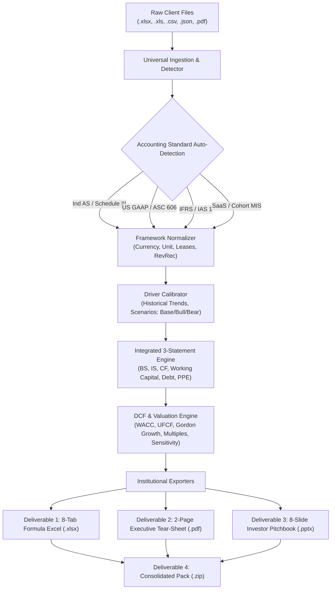

# Institutional Financial Modeling & Valuation Engine

A zero-touch, institutional-grade financial modeling platform that ingests raw client trial balances, ERP exports (Tally, Zoho, SAP, QuickBooks, NetSuite), or JSON/CSV/PDF financial statements, auto-detects accounting frameworks, runs a fully-integrated 3-statement forecast with DCF valuation, and compiles a synchronized 3-deliverable Executive Valuation Pack (**Excel Model**, **PDF Tear-Sheet**, **PowerPoint Pitchbook**, and **ZIP archive**).

---

## 1. System Architecture Overview



---

## 2. Universal Ingestion & Accounting Standard Auto-Detection

The Ingestion Layer (`src/ingestion/`) ingests financial statements with zero manual mapping:

### 2.1 Framework Auto-Detection
The framework detector (`detector.py`) inspects line-item nomenclature, taxonomy tags, and structure to classify the source data into one of four accounting standards:
* **Ind AS (Indian Accounting Standards / Companies Act Schedule III)**: Detects Indian nomenclature (*Trade Receivables, CWIP, Loans & Advances, Provisions, Exceptional Items, GST, Crores/Lakhs*).
* **US GAAP (FASB ASC)**: Identifies US GAAP standards (*Stockholders' Equity, Accounts Receivable, Common Stock, Paid-In Capital, Retained Earnings, SG&A*).
* **IFRS (IASB IAS 1 / IFRS 16)**: Identifies standard IFRS nomenclature (*Property Plant & Equipment, Borrowings, Right-of-Use Assets, Provisions, Finance Income*).
* **SaaS / Subscription MIS**: Recognizes recurring revenue models (*MRR, ARR, Net Revenue Retention, CAC, LTV, Churn Rate, Expansion ARR*).

### 2.2 Normalization & Compliance Adjustments
* **Currency & Denomination Scaling**: Automatically detects and normalizes across Crores, Lakhs, Millions, Billions, Thousands, and absolute units into consistent model scales.
* **Lease Accounting (IFRS 16 / ASC 842)**: Capitalizes operating leases onto the balance sheet as Right-of-Use (ROU) assets and lease liabilities with corresponding depreciation and finance charges.
* **Revenue Recognition (ASC 606 / Ind AS 115)**: Adjusts deferred revenue and contract asset balances for standardized timing recognition.

---

## 3. Integrated 3-Statement Forecast & DCF Valuation Engine

Located in `src/engine/`, the modeling engine guarantees strict mathematical and accounting equilibrium:

### 3.1 3-Statement Mechanics
* **Dynamic Drivers (`drivers.py`)**: Calibrates historical revenue CAGR, gross margins, EBITDA margins, DSO (receivable days), DII (inventory days), DPO (payable days), CapEx intensity, depreciation schedules, and tax rates. Generates 3 synchronized scenario sets (**Base**, **Bull**, **Bear**).
* **Income Statement (`model3s.py`)**: Forecasts operational revenues, COGS, operating expenses, EBITDA, D&A schedules, EBIT, interest expense on debt tranches, EBT, taxes, and PAT (Net Income).
* **Balance Sheet (`model3s.py`)**: Models working capital balances (AR, Inventory, AP), net fixed assets via CapEx/D&A roll-forwards, debt amortization schedules, equity accounts, and retained earnings progression.
* **Cash Flow Statement (`model3s.py`)**: Reconciles Operating Cash Flow (CFO via indirect method), Investing Cash Flow (CFI via CapEx), and Financing Cash Flow (CFF via debt issuance/repayment and dividends).
* **Cash Balancing**: Cash is closed dynamically; balance sheet identity ($Total Assets = Total Liabilities + Equity$) is strictly preserved with zero plug errors.

### 3.2 DCF Valuation & Sensitivity Analysis (`dcf.py`)
* **Cost of Capital (WACC)**: Computes Capital Asset Pricing Model (CAPM) Cost of Equity ($K_e = R_f + \beta \times ERP$) combined with after-tax Cost of Debt ($K_d \times (1 - t)$).
* **Unlevered Free Cash Flows (UFCF)**: Calculated as $\text{EBIT} \times (1 - t) + \text{D&A} - \text{CapEx} - \Delta\text{NWC}$.
* **Dual Terminal Value**: Evaluates terminal enterprise value using both the Perpetual Growth Model (Gordon Growth) and the Exit Multiple Method (EV/EBITDA).
* **2D Valuation Sensitivity Matrix**: Generates multi-variable sensitivity tables varying WACC (rows) against Terminal Growth Rate or Exit Multiple (columns).

---

## 4. Institutional 3-Deliverable Client Valuation Pack

The Exporter Layer (`src/exporters/`) delivers a synchronized executive valuation pack bundled into a single `.zip` distribution:

### Deliverable 1: Institutional 8-Tab Financial Model (`.xlsx`)
Compiled via `WorkbookCompiler` using openpyxl with zero hardcoded values in projections:
1. `01_Exec_Summary`: High-level company KPIs, valuation football field, and scenario switcher.
2. `02_Assumptions`: Centralized dynamic assumption table driven by Excel `CHOOSE(Scenario, ...)` formulas.
3. `03_Income_Statement`: Dynamically linked revenues, expenses, EBITDA, EBIT, and PAT.
4. `04_Balance_Sheet`: Working capital, PP&E, debt schedule, equity, and retained earnings with zero balance check cells (`Assets - Liabilities - Equity = 0`).
5. `05_Cash_Flow`: Fully linked indirect cash flow statement with ending cash reconciling to the Balance Sheet.
6. `06_Schedules`: Working capital schedules (DSO, DII, DPO), depreciation roll-forward, and debt amortization.
7. `07_DCF_&_Sensitivity`: Unlevered cash flows, discount factors, enterprise value, equity value, per share value, and two-way sensitivity matrix.
8. `08_Raw_Data`: Audit trail storing verbatim input data with source metadata.

### Deliverable 2: 2-Page Executive Valuation Tear-Sheet (`.pdf`)
Rendered via ReportLab in high-resolution corporate vector format:
* **Page 1**: Executive summary, transaction overview, key valuation metrics, and valuation football field visual comparison across scenarios.
* **Page 2**: Comprehensive 5-year 3-statement forecast snapshot, WACC vs TGR sensitivity table, liquidity analysis, and mathematical balance audit verification certificate.

### Deliverable 3: 8-Slide Investor & Board Pitchbook (`.pptx`)
Built via `python-pptx` with a custom institutional Navy/Slate executive theme:
* **Slide 1**: Title & Confidential Valuation Advisory Deck.
* **Slide 2**: Executive Summary & Core Transaction Highlights.
* **Slide 3**: Historical Financial Performance & Trajectory.
* **Slide 4**: 5-Year Integrated 3-Statement Projections.
* **Slide 5**: Valuation Football Field (Base vs Bull vs Bear).
* **Slide 6**: Discounted Cash Flow & Valuation Mechanics.
* **Slide 7**: 2D Valuation Sensitivity Heatmap (WACC vs Terminal Growth).
* **Slide 8**: Balance Sheet Health, Capital Structure & Solvency.

### Deliverable 4: Consolidated Pack Archive (`.zip`)
Bundles the three synchronized assets into `<clean_name>_Client_Valuation_Pack.zip` for automated delivery to clients and investors.

---

## 5. The 6 Institutional Verification Gates

The test suite enforces 6 mathematical and operational verification gates:

| Gate | Name | Target Metric / Acceptance Criteria | Implementation File |
| :--- | :--- | :--- | :--- |
| **Gate 1** | **Balance Sheet Identity** | $\vert\text{Total Assets} - (\text{Liabilities} + \text{Equity})\vert < 1\times 10^{-4}$ across all years and scenarios | `tests/test_gates.py` |
| **Gate 2** | **Cash & NI Reconciliation** | $\text{Closing Cash}_{CF} == \text{Cash}_{BS}$ and $\Delta\text{Retained Earnings} == \text{PAT} - \text{Dividends}$ | `tests/test_gates.py` |
| **Gate 3** | **Zero Formula Errors** | Total `#REF!`, `#VALUE!`, `#DIV/0!`, `#NAME?`, `#N/A`, `#NUM!` cells in `.xlsx` $\equiv 0$ | `tests/test_gates.py` |
| **Gate 4** | **Multi-Entity Stress Suite** | Flawless ingestion and compilation for Ind AS, US GAAP, and SaaS real-world dirty formats | `tests/test_real_data_stress.py` |
| **Gate 5** | **Live API Integration** | FastAPI endpoints respond 200 OK; dynamic model upload and download work end-to-end | `tests/test_gates.py` |
| **Gate 6** | **Cross-Deliverable Parity** | Revenue, EBITDA, Net Income, EV, and Equity Value match to 0.00 across JSON preview, `.xlsx`, `.pdf`, `.pptx`, and `.zip` | `tests/test_parity_gate6.py` |

---

## 6. Execution & Deployment Guide

### 6.1 CLI Usage (`finmodel`)

```bash
# Run against a single file (auto-detects and deposits valuation pack)
finmodel run --input inputs/clean_infosys_ind_as.xlsx --output client_outbox/

# Batch process an entire directory (processes all .xlsx, .csv, .json, .pdf files)
finmodel run --input client_inbox/ --output client_outbox/

# Run using the Python module directly
py -m src.cli run --input client_inbox/ --output client_outbox/

# Run continuous watch-folder daemon
finmodel watch --watch-dir client_inbox/ --output-dir client_outbox/ --interval 2.0
```

### 6.2 Docker Containerization

Build and run the production engine inside an isolated Linux container:

```bash
# Build the Docker image
docker build -t financial-engine:latest .

# Run container with mounted inbox and outbox volumes
docker run -d \
  -p 8000:8000 \
  -v $(pwd)/client_inbox:/app/client_inbox \
  -v $(pwd)/client_outbox:/app/client_outbox \
  --name financial-engine \
  financial-engine:latest

# Or launch via Docker Compose
docker-compose up -d
```

### 6.3 REST API & Web Dropzone Portal

The server runs on FastAPI (`src.ingestion.api:app`) exposing:
* `GET /`: Zero-click drag-and-drop web dropzone UI.
* `GET /portal`: MarketLens Analytics client portal.
* `POST /api/v1/model/generate-pack`: Multipart upload endpoint compiling the 3 deliverables and returning download URLs and metadata preview.
* `GET /api/v1/model/download/{filename}`: Download compiled `.xlsx`, `.pdf`, `.pptx`, or `.zip` packs.
* `GET /api/v1/health`: Liveness and health probe.

Launch the server locally:
```bash
py -m uvicorn src.ingestion.api:app --host 0.0.0.0 --port 8000 --reload
```

---

## 7. Running Verification Tests

Run all 6 verification gates with pytest:

```bash
# Run Gate 1 to Gate 5
py -m pytest tests/test_gates.py -v

# Run Gate 4 Real-Data Stress Suite
py -m pytest tests/test_real_data_stress.py -v

# Run Gate 6 Cross-Deliverable Parity Suite
py -m pytest tests/test_parity_gate6.py -v

# Run complete gate suite
py tests/run_all_gates.py
```
